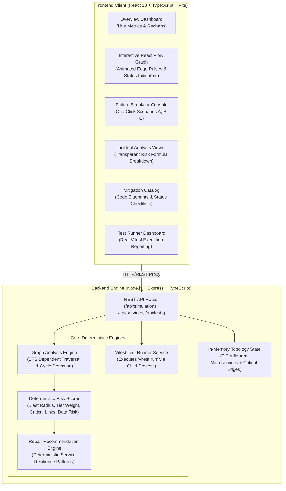

# PatchPilot — AI-Powered Software Failure Detective

> **Detect cascading failures before they become production outages.**  
> An observability developer tool that models microservice dependencies, simulates multi-tier outages via graph traversal, computes deterministic architectural risk scores, and provides service-aware repair mitigations.

---

## Table of Contents
1. [Executive Summary & Problem Statement](#executive-summary--problem-statement)
2. [Why This Problem Matters](#why-this-problem-matters)
3. [Solution Architecture](#solution-architecture)
4. [Technology Stack](#technology-stack)
5. [Key Features](#key-features)
6. [Dependency Analysis & Graph Traversal Engine](#dependency-analysis--graph-traversal-engine)
7. [Transparent Risk-Scoring Methodology](#transparent-risk-scoring-methodology)
8. [Deterministic Repair Recommendations](#deterministic-repair-recommendations)
9. [Automated Test Suite (Vitest)](#automated-test-suite-vitest)
10. [Quickstart & Installation](#quickstart--installation)
11. [Reproducible Demo Scenarios](#reproducible-demo-scenarios)
12. [API Reference](#api-reference)
13. [Screenshots](#screenshots)
14. [Known Limitations & Future Roadmap](#known-limitations--future-roadmap)
15. [Publishing to GitHub](#publishing-to-github)

---

## Executive Summary & Problem Statement

Modern cloud-native architectures rely on deeply interconnected webs of microservices. While microservices isolate business domains, they introduce **complex runtime dependency chains**. When a single backend service suffers a database pool exhaustion, latency spike, or third-party outage (e.g. Stripe gateway drop), the fault rarely stays contained. Instead, it cascades upstream through synchronous REST and gRPC calls, knocking down shopping carts, session validators, and API gateways.

Traditional observability tools (Datadog, AWS CloudWatch, Grafana) are primarily **reactive**: they alert on-call engineers *after* an outage occurs and when customers are already experiencing HTTP 500/504 errors. 

**PatchPilot solves this proactively:**
PatchPilot enables software architects and DevOps engineers to model system dependencies, inject simulated faults across any service node, visualize cascading blast radiuses in real time, calculate deterministic risk metrics, and review actionable resilience patterns (circuit breakers, exponential backoff, dead-letter queues) before deploying code to production.

---

## Why This Problem Matters

1. **Hidden Cascading Blast Radius:** An engineer updating a payment gateway may not realize that a synchronous timeout blocks the Order Service and starves API Gateway worker threads.
2. **False Assumptions About Isolation:** Leaf asynchronous consumers (like Notification Service) are often assumed to be dangerous, while single points of failure (like primary databases) are underestimated.
3. **High Mean Time to Resolution (MTTR):** During live incidents, debugging which service caused the root fault vs. which services are mere downstream victims consumes 70% of incident response time.
4. **Resilience Debt:** Without a tool to inspect dependency critical paths, teams neglect circuit breakers and fallback states until forced by major production incidents.

---

## Solution Architecture

PatchPilot is architected as a modular, full-stack developer tool comprising an interactive React Flow visualization engine, a deterministic graph traversal and risk evaluation core, and an Express REST API.



---

## Technology Stack

| Layer | Technology | Rationale & Responsibility |
| :--- | :--- | :--- |
| **Frontend Framework** | React 18 + TypeScript + Vite | Blazing-fast hot module reloading (HMR) and strict type safety |
| **Dependency Graph** | `@xyflow/react` (React Flow v12) | Interactive canvas, custom nodes, directional edges, zoom/pan controls |
| **Styling & UI/UX** | Tailwind CSS | Dark observability theme (`#080c14`, navy surfaces, glowing badges) |
| **Icons** | Lucide React | Consistent developer tool iconography (`Network`, `Shield`, `Activity`, etc.) |
| **Metrics & Charts** | Recharts | Distribution of healthy, failed, and affected cluster services |
| **Backend Runtime** | Node.js + Express + TypeScript | Lightweight, deterministic REST API with modular controllers |
| **Execution Tooling** | `tsx` | TypeScript execution without cumbersome compile steps in dev |
| **Testing Suite** | Vitest | 21 comprehensive unit and integration tests verifying traversal, scoring, and APIs |
| **Data Persistence** | In-Memory JSON Topology | Deterministic, local execution with zero third-party database dependencies |

---

## Key Features

1. **Interactive Service Topology Canvas:**
   - 7 microservices modeled across functional tiers: API Gateway, Authentication Service, Order Service, Payment Service, Inventory Service, Database Cluster, and Notification Service.
   - Distinct visual states: 🟢 Healthy (emerald), 🔴 Failed root cause (pulsing rose), 🟡 Affected downstream victim (amber).
   - Directional dependency edges showing synchronous REST, SQL queries, and asynchronous events.
   - Interactive zoom, pan, mini-map, and service inspection drawer.

2. **Deterministic Failure Simulation Engine:**
   - Inject faults into any individual service or execute pre-configured scenarios.
   - Real-time BFS traversal identifying all reachable downstream victims.
   - Instant computation of blast radius percentage and severed synchronous links.
   - Baseline reset button restoring nominal cluster health in one click.

3. **Transparent Risk-Scoring Formula:**
   - No opaque AI or hallucinated predictions.
   - Clear formula combining blast radius (0-35 pts), tier criticality (0-30 pts), critical path links (0-20 pts), and data persistence exposure (0-15 pts).
   - Categorizes risk into `LOW`, `MEDIUM`, `HIGH`, or `CRITICAL`.

4. **Service-Aware Repair Recommendations:**
   - Service-specific mitigation blueprints (e.g. idempotency keys and circuit breakers for Payment Service; connection pooling and read replicas for Database; dead-letter queues for Notification Service).
   - Actionable implementation code snippets copyable to clipboard.
   - Verification status toggles (`PROPOSED` ➔ `PENDING_REVIEW` ➔ `VERIFIED`).

5. **Integrated Automated Test Runner:**
   - Real automated test suite executed via Vitest.
   - UI displays test pass/fail status, test suite file, execution time in milliseconds, and the exact terminal command.
   - 21 automated tests verifying graph traversal, cycle handling, invalid edge resilience, risk boundaries, and recommendation rules.

---

## Dependency Analysis & Graph Traversal Engine

### Dependency Edge Semantics
PatchPilot establishes a strict, documented mathematical model for dependency edges:
- **Functional Dependency Edge (`Source ➔ Target`):**
  Represents that `Source` **depends upon** `Target` (Caller ➔ Callee).  
  *Example:* `order-service` ➔ `payment-service` means Order Service calls Payment Service during checkout.
- **Failure Cascade Propagation:**
  If `Target` experiences an outage, all services that rely on `Target` (`Source` and transitively any callers that rely on `Source`) experience cascading failure.  
  Therefore, failure propagates along the **reverse direction of the functional call edges**.

```
[API Gateway] ──(calls)──> [Order Service] ──(calls)──> [Payment Service]
                                                               │
                                                       (SIMULATED OUTAGE)
                                                               │
<═══ (Cascades Upstream) ══ <══════════════════════════════════╝
```

### Graph Algorithm Details
- **Adjacency Representation:** An in-memory Dependents Map (`targetId ➔ [callerId1, callerId2, ...]`) is constructed from the sanitized edge catalog.
- **Traversal Strategy:** Breadth-First Search (BFS) is initiated from the root failed service IDs.
- **Cycle Avoidance:** Traversal tracks visited nodes in a `Set<string>`. If circular dependencies exist (e.g., Service A ➔ Service B ➔ Service C ➔ Service A), the visited set terminates traversal, avoiding infinite loops.
- **Cycle Detection:** A 3-color DFS algorithm (White = unvisited, Gray = visiting, Black = finished) detects and isolates all active cycles in the topology.
- **Edge Sanitization:** Edges referencing missing or ghost service IDs are safely filtered without crashing the engine.

---

## Transparent Risk-Scoring Methodology

PatchPilot does not claim to predict live production outages with absolute certainty. Instead, it computes **dependency-based structural risk** on the configured service graph.

### Mathematical Formula

$$\text{Composite Risk Score} = \min\left(100, \; \text{BlastRadius} + \text{TierWeight} + \text{CriticalEdges} + \text{DataLoss}\right)$$

### Factor Breakdown (Total: 0 to 100 Points)

1. **Blast Radius Factor ($0 - 35$ Points):**
   $$\text{BlastRadius} = \min\left(35, \; \text{round}\left(\frac{\text{Affected Victims}}{\text{Total Services} - 1} \times 35\right)\right)$$
   Measures the mathematical proportion of the non-failed cluster affected by the cascade.

2. **Tier Importance Weight ($0 - 30$ Points):**
   - Root Failed Service: Tier 1 = 18 pts, Tier 2 = 10 pts, Tier 3 = 4 pts.
   - Downstream Victims: Each Tier-1 victim adds +4 pts; each Tier-2 victim adds +2 pts.
   - Clamped at 30 points maximum.

3. **Critical Path Severance ($0 - 20$ Points):**
   - Counts synchronous blocking RPC/REST edges severed along active failure paths ($5\text{ pts}$ per critical edge, up to 20 pts).

4. **Data Persistence & Ledger Risk ($0 - 15$ Points):**
   - Database cluster outage: 15 pts.
   - Financial payment transaction state: 12 pts.
   - Shopping cart / order lifecycle state: 10 pts.
   - Pure stateless / asynchronous messaging: 2 pts.

### Severity Thresholds
| Composite Score | Severity Level | Operational Impact |
| :---: | :---: | :--- |
| **0 – 24** | `LOW` | Isolated leaf failure; zero downstream service impact; background queues buffered. |
| **25 – 49** | `MEDIUM` | Localized degradation; non-critical pathways impacted; fallbacks operational. |
| **50 – 79** | `HIGH` | Mission-critical checkout or authentication journeys blocked; multi-tier cascade. |
| **80 – 100** | `CRITICAL` | Cluster-wide catastrophe; persistence or ingress collapse; 85%+ blast radius. |

---

## Deterministic Repair Recommendations

When a service fails, PatchPilot generates actionable mitigations tailored to that specific domain:

- **Payment Service Outage:**
  - *Mitigation:* Exponential backoff with jitter and deterministic idempotency keys (`Idempotency-Key: UUIDv4`).
  - *Mitigation:* Circuit breaker pattern with fallback `PAYMENT_PENDING_ASYNC` state to avoid checkout drop-off.
  - *Mitigation:* Transactional outbox pattern to decouple payment receipts from synchronous webhook delivery.
- **Database Cluster Crash:**
  - *Mitigation:* Connection pool exhaustion safeguards via PgBouncer / HikariCP with strict statement timeouts (3000ms).
  - *Mitigation:* Read-replica splitting for read-only catalog lookups to relieve primary node write locks.
  - *Mitigation:* Automated multi-AZ heartbeat failover verification with < 30s DNS CNAME flipping.
- **Notification Service Failure:**
  - *Mitigation:* Buffered queue processing via BullMQ / RabbitMQ with rate-limited consumer workers.
  - *Mitigation:* Multi-provider fallback routing (e.g., AWS SES fallback when SendGrid error rate exceeds 5%).
- **Authentication Service Outage:**
  - *Mitigation:* Local asymmetric RS256 JWT validation using JWKS key caching at the API Gateway.
  - *Mitigation:* Clustered Redis caching for session token revocation lists.

---

## Automated Test Suite (Vitest)

PatchPilot includes a real automated test suite with **21 tests** across 4 test suites:

```bash
# Run tests directly from terminal
npm test --workspace=server
```

### Verified Test Assertions:
1. `graph-engine.test.ts`:
   - Downstream dependent traversal for Payment Service outage (verifies Order, Gateway, Notifications affected; Auth, Inventory, DB healthy).
   - Leaf node isolation for Notification Service (verifies 0 affected downstream victims).
   - Catastrophic blast radius calculation for Database failure (6 out of 7 services affected).
   - Isolated node handling with zero connections.
   - Multi-branch fan-out dependency trees.
   - Circular dependency cycle detection without infinite loops (A ➔ B ➔ C ➔ A).
   - Missing node references & corrupted edge sanitization.
2. `risk-scorer.test.ts`:
   - LOW severity assignment to isolated leaf failure.
   - HIGH severity assignment to Payment Service outage with formula score breakdown.
   - CRITICAL severity assignment to Database cluster crash.
   - Complete structured Incident Report validation.
3. `recommendation-engine.test.ts`:
   - Payment-specific mitigations (idempotency, circuit breaker).
   - Database-specific mitigations (connection pooling, read replicas).
   - Notification-specific mitigations (queue buffering, multi-provider).
   - Incident response checklist summary generation.
4. `api.test.ts`:
   - `GET /api/health` probe verification.
   - `GET /api/services` baseline schema integrity.
   - `GET /api/dependencies` edge validation.
   - `POST /api/simulations` failure execution.
   - `POST /api/simulations/reset` cluster restoration.
   - `POST /api/scenarios/:scenarioId/apply` demo scenario execution.

---

## Quickstart & Installation

### Prerequisites
- **Node.js**: v18.0.0 or later (v20+ / v26+ supported)
- **npm**: v9.0.0 or later

### 1. Clone & Install Dependencies
```bash
git clone https://github.com/your-username/patchpilot.git
cd patchpilot

# Install dependencies across all workspaces
npm install
```

### 2. Start Development Environment
```bash
# Starts Express backend (port 3001) and Vite frontend (port 5173) concurrently
npm run dev
```

Open your browser to **http://localhost:5173** to access the PatchPilot dashboard.

### 3. Run Automated Tests
```bash
# Execute the full 21-test Vitest suite
npm test --workspace=server
```

### 4. Build for Production
```bash
# Compile server TypeScript and client Vite bundle
npm run build

# Start production server
npm run start
```

---

## Reproducible Demo Scenarios

PatchPilot provides 3 one-click scenarios accessible from the Overview Dashboard and Failure Simulator:

### Scenario A: Payment Service Outage (High Severity)
- **Target:** `payment-service` (Tier 1 Core)
- **Action:** Click "Run Scenario" on Scenario A card.
- **Expected Result:**
  - `order-service` and `notification-service` are affected.
  - `api-gateway` is transitively affected via Order Service.
  - `auth-service`, `inventory-service`, and `database` remain **HEALTHY**.
  - Risk Severity: **HIGH** (Score: ~66/100).
  - Mitigations: Idempotency keys, circuit breakers with fallback states.

### Scenario B: Database Cluster Crash (Critical Catastrophe)
- **Target:** `database` (Tier 1 Primary Cluster)
- **Action:** Click "Run Scenario" on Scenario B card.
- **Expected Result:**
  - `auth-service`, `order-service`, `inventory-service`, and `payment-service` fail.
  - Cascades upstream to `api-gateway` and `notification-service`.
  - Blast Radius: **85%+** (6 of 7 services affected).
  - Risk Severity: **CRITICAL** (Score: 100/100).
  - Mitigations: PgBouncer pool limits, read-replica routing, multi-AZ automated failover.

### Scenario C: Notification Service Failure (Low Severity Leaf)
- **Target:** `notification-service` (Tier 3 Leaf Consumer)
- **Action:** Click "Run Scenario" on Scenario C card.
- **Expected Result:**
  - Downstream Victims: **0** (Empty list).
  - Blast Radius: **0%**.
  - Upstream services (`order-service`, `payment-service`, `api-gateway`) are **NOT** falsely flagged as victims.
  - Risk Severity: **LOW** (Score: ~6/100).
  - Mitigations: Message queue buffering and multi-vendor fallback routing.

---

## API Reference

The backend exposes a modular REST API on port `3001` (proxied automatically by Vite on `/api` during frontend development):

| Method | Endpoint | Description |
| :--- | :--- | :--- |
| `GET` | `/api/health` | Health check probe and uptime metadata |
| `GET` | `/api/services` | Returns all microservice nodes and current operational statuses |
| `GET` | `/api/dependencies` | Returns all directed dependency edges |
| `POST` | `/api/simulations` | Injects synthetic failure (`{ "serviceId": "payment-service" }`) |
| `POST` | `/api/simulations/reset` | Resets cluster state back to baseline healthy |
| `GET` | `/api/incidents` | Fetches historical incident reports |
| `GET` | `/api/recommendations/:serviceId` | Returns deterministic repair mitigations for a service |
| `GET` | `/api/scenarios` | Lists configured demo scenarios (A, B, C) |
| `POST` | `/api/scenarios/:scenarioId/apply`| Executes a specific demo scenario |
| `GET` | `/api/tests` | Returns last verified Vitest test suite summary |
| `POST` | `/api/tests/run` | Triggers a live child process run of `vitest run` and returns results |

---

## Screenshots

To add real screenshots of your running PatchPilot application:
1. Start the app: `npm run dev`
2. Open `http://localhost:5173` in your browser.
3. Take screenshots of:
   - **Overview Dashboard:** Showing cluster health and metric cards.
   - **Interactive Dependency Map:** Showing React Flow with node statuses.
   - **Failure Simulator:** Demonstrating active Scenario A failure.
   - **Incident Analysis:** Showing the transparent risk breakdown and propagation paths.
   - **Mitigation Catalog:** Showing code blueprints.
   - **Automated Test Results:** Showing 21 passing Vitest assertions.
4. Save the images to a `docs/screenshots/` folder in the repository and reference them:

```markdown


```

---

## Known Limitations & Future Roadmap

### Current MVP Scope
- Operates locally on configured topological graphs without requiring production cloud credentials.
- Graph modifications persist in-memory during the server session.
- Recommendations are generated deterministically based on engineering resilience patterns.

### Future Improvements
1. **Dynamic OpenTelemetry Ingestion:** Ingest real OpenTelemetry (OTel) traces and Prometheus metrics to automatically build and update dependency graphs.
2. **Multi-Failure Cascade Simulation:** Simulate concurrent multi-node outages and split-brain network partitions.
3. **Chaos Engineering Webhooks:** Integrate with Gremlin, Chaos Mesh, or LitmusChaos to execute actual canary chaos tests in Kubernetes staging clusters.
4. **Interactive Graph Topology Editor:** Allow users to drag-and-drop new microservices and draw custom dependency edges directly from the UI.

---

## Publishing to GitHub

To push PatchPilot to your GitHub repository:

```bash
# 1. Initialize git (if not already initialized)
git init

# 2. Add all files (respecting .gitignore)
git add .

# 3. Commit changes
git commit -m "feat: complete PatchPilot MVP with dependency engine, failure simulator, and tests"

# 4. Set main branch
git branch -M main

# 5. Link your remote GitHub repository
git remote add origin https://github.com/YOUR_USERNAME/patchpilot.git

# 6. Push to GitHub
git push -u origin main
```

---

## License

MIT License. Built for developers building resilient distributed systems.
