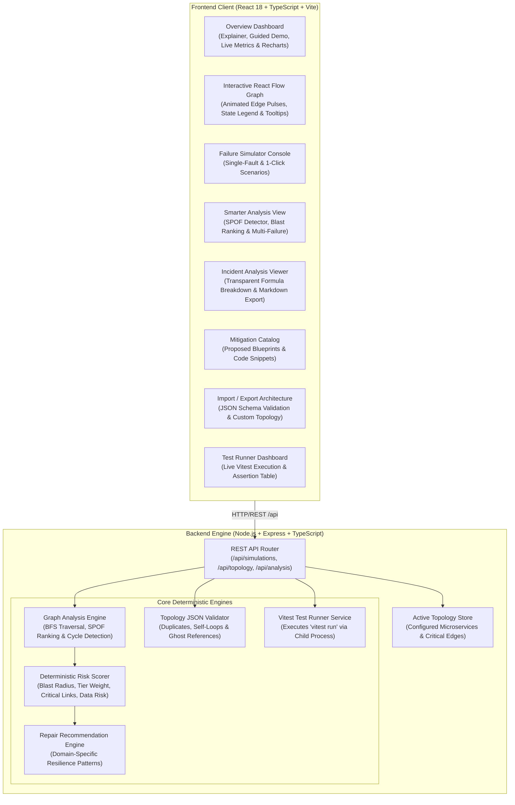

# PatchPilot — AI-Powered Software Failure Detective

> **Detect cascading failures before they become production outages.**  
> An observability developer tool that models microservice dependencies, simulates single and multi-service outages via graph traversal, detects Single Points of Failure (SPOFs), computes deterministic architectural risk scores, and provides service-aware repair mitigations.

---

## Table of Contents
1. [Executive Summary & Problem Statement](#executive-summary--problem-statement)
2. [Why This Problem Matters](#why-this-problem-matters)
3. [Solution Architecture](#solution-architecture)
4. [Technology Stack](#technology-stack)
5. [Key Features](#key-features)
6. [Dependency Analysis & Graph Traversal Engine](#dependency-analysis--graph-traversal-engine)
7. [Transparent Risk-Scoring Methodology](#transparent-risk-scoring-methodology)
8. [Bring-Your-Own Architecture (Import / Export)](#bring-your-own-architecture-import--export)
9. [Smarter Analysis: SPOF Detector & Multi-Failure Engine](#smarter-analysis-spof-detector--multi-failure-engine)
10. [Automated Test Suite (35 Vitest Tests)](#automated-test-suite-35-vitest-tests)
11. [Quickstart & Single-Service Deployment](#quickstart--single-service-deployment)
12. [Reproducible Demo Scenarios](#reproducible-demo-scenarios)
13. [2-Minute Demo Script for Judges](#2-minute-demo-script-for-judges)
14. [API Reference](#api-reference)
15. [Screenshots](#screenshots)
16. [Known Limitations & Future Roadmap](#known-limitations--future-roadmap)
17. [Publishing to GitHub](#publishing-to-github)

---

## Executive Summary & Problem Statement

Modern cloud-native architectures rely on deeply interconnected webs of microservices. While microservices isolate business domains, they introduce **complex runtime dependency chains**. When a single backend service suffers a database pool exhaustion, latency spike, or third-party outage (e.g. Stripe gateway drop), the fault rarely stays contained. Instead, it cascades upstream through synchronous REST and gRPC calls, knocking down shopping carts, session validators, and API gateways.

Traditional observability tools (Datadog, AWS CloudWatch, Grafana) are primarily **reactive**: they alert on-call engineers *after* an outage occurs and when customers are already experiencing HTTP 500/504 errors.

**PatchPilot solves this proactively:**
PatchPilot enables software architects and DevOps engineers to model system dependencies, inject simulated faults across single or multiple services, visualize cascading blast radiuses in real time, calculate deterministic risk metrics, and review actionable resilience patterns (circuit breakers, exponential backoff, dead-letter queues) before deploying code to production.

---

## Why This Problem Matters

1. **Hidden Cascading Blast Radius:** An engineer updating a payment gateway may not realize that a synchronous timeout blocks the Order Service and starves API Gateway worker threads.
2. **False Assumptions About Isolation:** Leaf asynchronous consumers (like Notification Service) are often assumed to be dangerous, while single points of failure (like primary databases) are underestimated.
3. **High Mean Time to Resolution (MTTR):** During live incidents, debugging which service caused the root fault vs. which services are mere downstream victims consumes 70% of incident response time.
4. **Resilience Debt:** Without a tool to inspect dependency critical paths, teams neglect circuit breakers and fallback states until forced by major production incidents.

---

## Solution Architecture

PatchPilot is architected as a modular, full-stack developer tool. Express can serve both the REST API and the built production SPA as **ONE unified service**.



---

## Technology Stack

| Layer | Technology | Rationale & Responsibility |
| :--- | :--- | :--- |
| **Frontend Framework** | React 18 + TypeScript + Vite | Blazing-fast hot module reloading (HMR) and strict type safety |
| **Dependency Graph** | `@xyflow/react` (React Flow v12) | Interactive canvas, custom nodes, directional edges, zoom/pan controls |
| **Styling & UI/UX** | Tailwind CSS | Dark observability theme (`#080c14`, navy surfaces, glowing badges) |
| **Icons** | Lucide React | Consistent developer tool iconography (`Network`, `Shield`, `Activity`, etc.) |
| **Metrics & Charts** | Recharts | Distribution of healthy, failed, and affected cluster services |
| **Backend Runtime** | Node.js + Express + TypeScript | Modular REST API with deterministic traversal and validation engines |
| **Testing Suite** | Vitest | 35 comprehensive automated tests verifying algorithms, scoring, and APIs |
| **Single-Service Deploy** | Express Static SPA Serving | Serves production build from `client/dist` directly as one unified process |

---

## Key Features

1. **Self-Explanatory Developer UI:**
   - Plain-language explainer panel: *"Pick a service, simulate a failure, and see which other services would be affected. This is a simulation on a configured service graph, not live monitoring."*
   - Interactive 3-step guided demo walking through Scenario A automatically.
   - Comprehensive tooltips on severity badges, node colors, and edge directions.
   - Prominent edge semantics banner: `A ➔ B means "A depends on B"`.

2. **Bring-Your-Own Architecture (Import / Export):**
   - Import custom JSON topologies with strict validation (rejection of duplicate IDs, ghost node references, self-loops, and invalid fields).
   - Instant re-rendering of graph, simulator, risk scorer, and mitigations on the imported topology.
   - One-click export of current topology as JSON.
   - One-click restore of the baseline e-commerce graph.

3. **Smarter Architectural Analysis (100% Deterministic & Computed):**
   - **Single Point of Failure (SPOF) Detector:** Highlights services whose individual failure takes down $\ge 40\%$ of the cluster or $\ge 3$ services.
   - **Blast-Radius Ranking Table:** Computed dynamically across all services in the graph, ranked descending by blast radius and severity.
   - **Concurrent Multi-Failure Simulator:** Select 2+ services at once to test simultaneous combined outages and view combined impact.
   - **Deepest Call Hierarchy & Cycle Guard:** Computes longest transitive dependency chain (4 hops in sample graph) and verifies DAG acyclic status.

4. **Incident Report Markdown Export:**
   - Download complete incident reports as `.md` files directly from the UI or via API (`GET /api/incidents/:id/export`).
   - Labeled with: `NOTICE: SIMULATED incident. Not a real production outage.`

5. **Integrated Automated Test Runner:**
   - 35 automated tests executing Vitest via backend child process with real execution times and CLI instructions.

---

## Dependency Analysis & Graph Traversal Engine

### Dependency Edge Semantics
- **Functional Dependency Edge (`Source ➔ Target`):**
  Represents that `Source` **depends upon** `Target` (Caller ➔ Callee).  
  *Example:* `order-service` ➔ `payment-service` means Order Service calls Payment Service during checkout.
- **Failure Cascade Propagation:**
  If `Target` experiences an outage, all services that rely on `Target` experience cascading failure.  
  Therefore, failure propagates along the **reverse direction of the functional call edges**.

```
[API Gateway] ──(calls)──> [Order Service] ──(calls)──> [Payment Service]
                                                               │
                                                       (SIMULATED OUTAGE)
                                                               │
<═══ (Cascades Upstream) ══ <══════════════════════════════════╝
```

---

## Transparent Risk-Scoring Methodology

$$\text{Composite Risk Score} = \min\left(100, \; \text{BlastRadius} + \text{TierWeight} + \text{CriticalEdges} + \text{DataLoss}\right)$$

1. **Blast Radius Factor ($0 - 35$ Points):**
   $$\text{BlastRadius} = \min\left(35, \; \text{round}\left(\frac{\text{Affected Victims}}{\text{Total Services} - 1} \times 35\right)\right)$$
2. **Tier Importance Weight ($0 - 30$ Points):**
   - Root Failed Service: Tier 1 = 18 pts, Tier 2 = 10 pts, Tier 3 = 4 pts.
   - Downstream Victims: +4 pts per Tier-1 victim; +2 pts per Tier-2 victim (clamped at 30 pts).
3. **Critical Path Severance ($0 - 20$ Points):**
   - 5 pts per synchronous critical REST/RPC link severed along active paths.
4. **Data Persistence & Ledger Risk ($0 - 15$ Points):**
   - Database cluster = 15 pts; financial transaction state = 12 pts; shopping cart state = 10 pts; stateless = 2 pts.

### Severity Thresholds
- **0 – 24 pts:** `LOW` (Isolated leaf failure, 0 downstream victims)
- **25 – 49 pts:** `MEDIUM` (Localized impact, auxiliary services degraded)
- **50 – 79 pts:** `HIGH` (Multi-tier cascade, checkout or auth blocked)
- **80 – 100 pts:** `CRITICAL` (System-wide outage, database collapse, 85%+ blast radius)

---

## Bring-Your-Own Architecture (Import / Export)

### Custom JSON Format Example
```json
{
  "services": [
    { "id": "web-portal", "name": "Web Customer Portal", "criticality": "tier-1" },
    { "id": "auth-service", "name": "User Auth Provider", "criticality": "tier-1" },
    { "id": "payment-api", "name": "Payment Gateway API", "criticality": "tier-1" },
    { "id": "shipping-svc", "name": "Shipping Logistics", "criticality": "tier-2" },
    { "id": "email-worker", "name": "Email Dispatcher", "criticality": "tier-3" }
  ],
  "dependencies": [
    { "from": "web-portal", "to": "auth-service" },
    { "from": "web-portal", "to": "payment-api" },
    { "from": "payment-api", "to": "shipping-svc" },
    { "from": "shipping-svc", "to": "email-worker" }
  ]
}
```

### Validation Rules Enforced:
1. **Duplicate IDs:** Rejects duplicate service IDs with specific error messages.
2. **Ghost References:** Rejects dependencies pointing to non-existent service IDs.
3. **Self-Loops:** Rejects services that depend on themselves (`from === to`).
4. **Invalid Fields:** Requires non-empty string IDs and names.

---

## Smarter Analysis: SPOF Detector & Multi-Failure Engine

1. **SPOF Detector:** Scans every service and identifies bottlenecks where failure impacts $\ge 40\%$ of the cluster. In the baseline e-commerce graph, **Database Cluster** (6 victims, 100% blast radius) and **Payment Service** (3 victims, 50% blast radius) are detected as SPOFs.
2. **Blast-Radius Ranking Table:** Dynamically calculated table ranking all services from highest impact to lowest.
3. **Multi-Failure Simulator:** Select 2 or more services concurrently (e.g. `payment-service` + `auth-service`) to simulate combined multi-point outages.
4. **Longest Dependency Chain:** Calculates the deepest transitive call path (4 hops: Gateway ➔ Order ➔ Payment ➔ Database) and validates absence of cycles.

---

## Automated Test Suite (35 Vitest Tests)

Run the full suite directly with:
```bash
npm test
```

### Test Coverage Across 6 Test Suites:
- `graph-engine.test.ts` (7 tests): BFS traversal, leaf isolation, persistence cascade, isolated nodes, multi-branch fan-out, circular dependency cycles without loops, missing node resilience.
- `risk-scorer.test.ts` (4 tests): LOW, HIGH, CRITICAL severities, and transparent formula breakdown.
- `recommendation-engine.test.ts` (4 tests): Service-specific resilience patterns, database connection pooling, and checklists.
- `topology-import.test.ts` (8 tests): Rejection of duplicate IDs, self-loops, ghost references, schema validation, API import & restore.
- `smarter-analysis.test.ts` (6 tests): SPOF detector, blast-radius ranking, longest chain computation, circular dependency guards, multi-failure simulation.
- `api.test.ts` (6 tests): Health probe, services, dependencies, simulations, resets, demo scenarios.

---

## Quickstart & Single-Service Deployment

### Option A: Development Mode (Hot Reloading)
```bash
cd /Users/jayjadhao/documents/patchpilot
npm install
npm run dev
```
- Client runs on `http://localhost:5173`
- Backend runs on `http://localhost:3001`

### Option B: Production Single-Service (Express Serves Both API & UI)
```bash
cd /Users/jayjadhao/documents/patchpilot
npm run build
npm start
```
- Express starts on port `3001` and serves both the REST API (`/api/...`) and the built React SPA (`/`) as **ONE unified process**. Open `http://localhost:3001`.

---

## Reproducible Demo Scenarios

| Scenario | Root Cause | Affected Victims | Severity | Key Mitigations |
| :--- | :--- | :--- | :---: | :--- |
| **Scenario A** | `payment-service` | `order-service`, `notification-service`, `api-gateway` | **HIGH** (Score: 66) | Idempotency keys (`UUIDv4`), Circuit breaker with `PAYMENT_PENDING_ASYNC` fallback, Outbox pattern |
| **Scenario B** | `database` | `auth-service`, `order-service`, `inventory-service`, `payment-service`, `api-gateway`, `notification-service` | **CRITICAL** (Score: 100) | PgBouncer pool limits, 3000ms statement timeouts, Read-replica query routing, Multi-AZ failover |
| **Scenario C** | `notification-service` | **None (0 victims)** | **LOW** (Score: 6) | Queue-based buffering (BullMQ), rate-limiting consumers, multi-provider SMS/email fallback |

---

## 2-Minute Demo Script for Judges

- **[0:00 - 0:30] Introduction & Value Proposition:**  
  *"Welcome to PatchPilot. Microservices fail unpredictably, and engineers often don't realize how a failure in Payment or Database knocks down upstream checkout flows. PatchPilot is a proactive failure detective that simulates outages on a configured service graph before code goes to production."*
- **[0:30 - 1:00] 3-Step Guided Demo & Dependency Graph:**  
  *Click 'Start Guided Demo' on the Overview page. Show Payment Service fail, watch the graph highlight Order Service and API Gateway as amber affected victims, while Auth and Inventory stay green. Explain the edge semantics banner: 'A ➔ B means A depends on B'.*
- **[1:00 - 1:30] Smarter Analysis & Multi-Failure:**  
  *Navigate to the 'Smarter Analysis' tab. Point out the SPOF Detector identifying the Database as a critical bottleneck (6 victims). Switch to the Multi-Failure console, select both Payment Service and Auth Service, and click 'Simulate Combined Multi-Failure' to demonstrate concurrent cascade.*
- **[1:30 - 2:00] Bring-Your-Own Architecture & Verification:**  
  *Click 'Import Architecture', show JSON validation rejecting self-loops and duplicate IDs. Switch to 'Incident Analysis', click 'Download Report (.md)' showing the transparent risk breakdown and SIMULATED disclaimer. Finally, show the 'Test Results' tab with 35 passing Vitest tests.*

---

## Screenshots

To capture genuine screenshots:
1. Start the app: `npm run dev`
2. Open `http://localhost:5173` in your browser.
3. Save genuine screenshots to `docs/screenshots/`:
   - `overview-dashboard.png` (Overview with guided demo and cluster health)
   - `dependency-graph.png` (React Flow topology with active failure cascade)
   - `smarter-analysis.png` (SPOF Detector and Blast-Radius Ranking Table)
   - `import-architecture.png` (JSON import with schema validator)
   - `incident-report.png` (Incident analysis and risk score breakdown)
   - `test-results.png` (35 passing Vitest test assertions)

---

## Known Limitations & Future Roadmap

### Known Limitations
- Operates locally on configured topological graphs; does not connect to live production cloud agents.
- Topology modifications persist in-memory during server runtime.
- Mitigations are proposed resilience blueprints and do not modify production repository code automatically.

### Future Roadmap
1. OpenTelemetry (OTel) live trace ingestion to automatically map dependencies from production spans.
2. Chaos engineering webhooks integrating with LitmusChaos or Chaos Mesh for Kubernetes.
3. Visual drag-and-drop architecture builder to draw new nodes directly on the React Flow canvas.

---

## Publishing to GitHub

```bash
git init
git add .
git commit -m "feat: complete PatchPilot with SPOF detector, multi-failure, import/export, and tests"
git branch -M main
git remote add origin https://github.com/YOUR_USERNAME/patchpilot.git
git push -u origin main
```
